  

  
  &nbsp;
  

 

<picture>
  <source media="(prefers-color-scheme: dark)" srcset="assets/titulo-sobre-escuro.svg">
  
</picture>

Sou **Gabriel Ribeiro**, desenvolvedor web full stack em Ilhabela (SP). Crio **sites, lojas virtuais e sistemas** que unem design, tecnologia e inteligência artificial: interfaces modernas e animações refinadas por fora; banco de dados, painéis e automações por dentro.

  

 

<picture>
  <source media="(prefers-color-scheme: dark)" srcset="assets/titulo-projetos-escuro.svg">
  
</picture>

  

  

  
  

 

<picture>
  <source media="(prefers-color-scheme: dark)" srcset="assets/titulo-stack-escuro.svg">
  
</picture>

  

 

<picture>
  <source media="(prefers-color-scheme: dark)" srcset="assets/titulo-entrego-escuro.svg">
  
</picture>

  

 

  

  Ilhabela, SP · Brasil — as artes deste perfil são SVGs animados gerados por <a href="build/gerar.mjs"><code>build/gerar.mjs</code></a>, com a paleta, a fonte e a marca do <a href="https://portfolio-gabriel-b.vercel.app">portfólio</a>.

